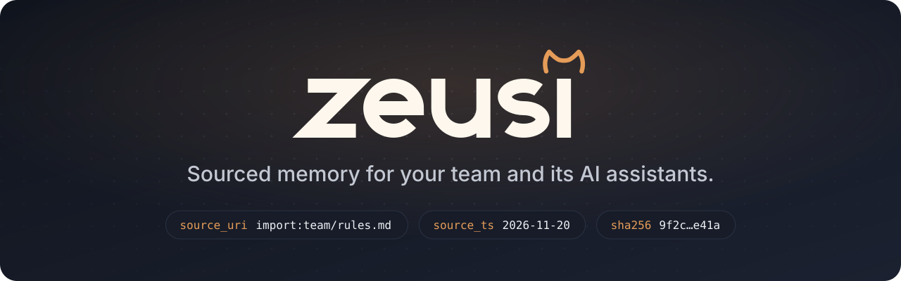
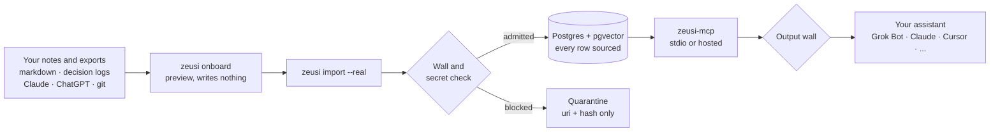

<p align="center">
  <a href="https://zeusi.ai">
    <picture>
      <source media="(prefers-color-scheme: dark)" srcset="docs/assets/banner-dark.svg">
      <source media="(prefers-color-scheme: light)" srcset="docs/assets/banner-light.svg">
      
    </picture>
  </a>
</p>

<p align="center">
  <b>Sourced memory for your team and its AI assistants.</b><br>
  Every answer says where it came from.
</p>

<p align="center">
  <a href="https://github.com/Sovra-GmbH/zeusi-public/actions/workflows/ci.yml"></a>
  <a href="LICENSE"></a>
  
  
  
  <a href="docs/mcp.md"></a>
</p>

<p align="center">
  <a href="https://zeusi.ai">Website</a> ·
  <a href="#quick-start">Quick start</a> ·
  <a href="docs/mcp.md">MCP docs</a> ·
  <a href="docs/wall.md">The wall</a> ·
  <a href="SECURITY.md">Security</a>
</p>

---

## What Zeusi is

Zeusi is a memory that your AI assistants share. It keeps your standing rules, current focus, decisions, notes and work history in Postgres with pgvector.

Every row carries its source: `source_uri`, `source_ts`, a content hash and the ingest run that wrote it. So when an assistant answers from Zeusi, it can cite where the answer came from, and it never has to invent one.

Any [MCP](https://modelcontextprotocol.io) client can use it: Grok Bot, Claude, Cursor, ChatGPT, VS Code, Gemini CLI and more. Use the hosted server, or run your own.

> [!NOTE]
> Your memory is encrypted. Only you hold the key. It is not hidden from the people who run Zeusi while you are signed in: the Zeusi server then decrypts your memory to answer your assistant. Whoever holds the admin database login can see that your workspace exists, how many items it holds, how large they are and when it changes.
>
> Your workspace is not end-to-end encrypted.
>
> Details: [zeusi.ai/security](https://zeusi.ai/security). On your own server, workspace keys are off by default; the `ZEUSI_WORKSPACE_ENCRYPTION` setting turns them on with `enroll` or `on` ([`src/workspace-keys.ts`](src/workspace-keys.ts)).

> [!IMPORTANT]
> A Zeusi decision is context, not permission. Decisions and locks returned by Zeusi are cited context for the assistant; they are not an approval or a GO to act now. Anything that needs the owner's approval still needs the owner's current, explicit approval.

## Features

- 🔗 **Every answer is sourced.** Facts, decisions, notes and chunks all keep `source_uri` and `source_ts`; startup rules also carry a ready-made `cite`. ([`migrations/0001_core.sql`](migrations/0001_core.sql))
- 🧭 **A startup brief for your assistant.** `zeusi_startup` returns every current standing rule, the current focus and recent decisions in one call. ([`src/mcp-server.ts`](src/mcp-server.ts))
- 🎯 **Context for the task at hand.** `zeusi_context_for_task` (alias `prime`) returns the decisions and locks that apply to a task, and flags conflicts between them. ([`src/context-for-task.ts`](src/context-for-task.ts))
- 🔎 **Hybrid search.** Vector plus full-text search. Without an embeddings key it falls back to lexical search and says so. ([`src/search.ts`](src/search.ts))
- 🗣️ **Decisions with the exact words.** Each decision keeps who said it and what they said. Changes go through supersede functions, not edits, with views for the current state. ([`src/decisions.ts`](src/decisions.ts))
- 🧱 **A wall in the database.** A trigger on every content table runs the same verdict as the importers, including protected names and many look-alike spellings of them (known limits in [`docs/wall.md`](docs/wall.md#parity-limits-wallts-vs-sql)). A blocked item is quarantined by uri and hash only. ([`docs/wall.md`](docs/wall.md))
- 🛡️ **Checked on the way out.** Every item an assistant gets passes an output wall and a secret check first. An item goes out whole or not at all. ([`src/mcp-wall.ts`](src/mcp-wall.ts))
- 👀 **Preview first, always.** `zeusi onboard` reads markdown or Obsidian notes, decision logs, Claude and ChatGPT exports and git repos, shows what it would import, and never writes. ([`src/importers/onboard.ts`](src/importers/onboard.ts))
- 🔐 **Sign in with GitHub.** The hosted server uses OAuth 2.1 with PKCE. Operator team members reach the team workspace; every other GitHub account gets its own personal workspace. Sign-in is read-only. The one exception: when the server has workspace writes on, a personal workspace's sign-in can also save into that same workspace, and only after a preview and your yes. Team sign-ins stay read-only. ([`src/mcp-oauth.ts`](src/mcp-oauth.ts))
- 🧑‍⚖️ **Least-privilege roles.** SQL creates the logins with no passwords: ingest, backup, read-only for agents and a narrow decision writer. ([`docs/roles.md`](docs/roles.md))
- 💸 **A hard spend cap on embeddings.** Embedding runs stop at a monthly cap and reuse vectors for unchanged text. ([`docs/embeddings.md`](docs/embeddings.md))

## How it works



Your assistant calls `zeusi_startup` at the start of a session, `zeusi_context_for_task` at the start of a task, and `zeusi_search` before it answers or asks you. Every item it gets back names its source.

## Quick start

### Option 1: Use the hosted server

Point your MCP client at **`https://mcp.zeusi.dev/mcp`** (Streamable HTTP) and sign in with GitHub. Unless you are on the operator's team, your GitHub account gets its own personal workspace, empty at first.

<details open>
<summary><b>Grok Bot</b></summary>

Add Zeusi as an MCP connector with the URL `https://mcp.zeusi.dev/mcp`. Sign in with GitHub when asked and approve the Zeusi consent screen (or send a read token as `Authorization: Bearer <token>`). Then copy [`skills/zeusi-startup/`](skills/zeusi-startup/SKILL.md) as-is into your skills.

</details>

<details>
<summary><b>Claude Code</b></summary>

```sh
claude mcp add --transport http zeusi https://mcp.zeusi.dev/mcp
```

Then run `/mcp` in a Claude Code session and choose to authenticate `zeusi`.

</details>

<details>
<summary><b>claude.ai / Claude Desktop</b></summary>

**Customize > Connectors**, then **+ Add** > **Add custom connector**. Name it `Zeusi`, enter `https://mcp.zeusi.dev/mcp`, and sign in.

</details>

<details>
<summary><b>Cursor</b></summary>

Add this to `~/.cursor/mcp.json` (all projects) or `.cursor/mcp.json` (one project), then follow the sign-in prompt under **Customize > MCPs**:

```json
{
  "mcpServers": {
    "zeusi": { "url": "https://mcp.zeusi.dev/mcp" }
  }
}
```

</details>

<details>
<summary><b>ChatGPT, VS Code, Gemini CLI and others</b></summary>

See [`docs/mcp.md`](docs/mcp.md#startup-snippets) for the steps for each client.

</details>

**Fill your memory.** If your workspace has write access, ask your assistant to fill your memory. It shows a preview first (`zeusi_import_preview`) and saves nothing until you say yes (`zeusi_import_commit`).

### Option 2: Run your own

Requirements: **Node.js 22.18+** and **PostgreSQL 16+** with the `vector` extension (Neon works out of the box; any Postgres with pgvector works).

```sh
git clone https://github.com/Sovra-GmbH/zeusi-public.git zeusi && cd zeusi
npm ci && npm run build && npm test     # tests run on PGlite, no database needed
```

`npm start -- <command>` runs the CLI (the same as `node dist/cli.js <command>`). Then:

1. **Connect a database.** Put the owner connection strings in `.env.local` (gitignored; names in [`.env.example`](.env.example)).
2. **Migrate, dry run first.**
   ```sh
   npm start -- migrate --dry-run
   npm start -- migrate
   ```
   Once a database has applied migrations, take a snapshot first and add `--i-took-a-snapshot`.
3. **Set role passwords and the service file.** The migrations create login roles without passwords. Set them as the owner, then copy [`config/pg_service.example.conf`](config/pg_service.example.conf) to `~/.pg_service.conf`. Check with `npm start -- doctor`. See [`docs/roles.md`](docs/roles.md).
4. **Preview your import.** `onboard` is always a dry run: no database connection, nothing written. It prints the counts and the exact command to run next.
   ```sh
   npm start -- onboard --markdown ~/notes --scope work
   ```
5. **Import and embed.** Run the `zeusi import ... --real` command that `onboard` printed. Then embed, estimate first:
   ```sh
   npm start -- embed --estimate
   npm start -- embed --dry-run
   npm start -- embed --real
   ```
6. **Connect an assistant over stdio.**
   ```json
   { "mcpServers": { "zeusi": { "command": "node", "args": ["/path/to/zeusi/dist/mcp.js"] } } }
   ```
   or `claude mcp add zeusi -- node /path/to/zeusi/dist/mcp.js`.

**Optional: a markdown vault.** Copy [`config/sources.example.toml`](config/sources.example.toml) to `config/sources.toml` (gitignored) and point it at your vault. Run `npm start -- ingest vault --dry-run` (counts only) before `--real`. Then `npm start -- wall report` lists what the wall held back (no content) and `npm start -- wall audit` checks that no stored row breaks it. See [`docs/wall.md`](docs/wall.md).

To run your own hosted server, use `node dist/mcp.js --hosted`. It fails closed until a valid tokens file exists. See [`docs/hosting.md`](docs/hosting.md).

> [!TIP]
> Credentials stay on the machine that runs the server (`~/.pg_service.conf` plus the macOS Keychain or `~/.pgpass`). They never go into a client config, a skill, a prompt or this repo.

## MCP tools

| Tool | What it does |
|---|---|
| `zeusi_startup` | Standing rules, current focus and recent decisions for the start of a session. |
| `zeusi_context_for_task` | The decisions, locks and parked items that apply to a task, with conflicts. |
| `zeusi_search` | Hybrid search over chunks and decisions; every hit cites its source. |
| `zeusi_search_feedback` | Say whether a search or context result answered the question. |
| `zeusi_onboarding_status` | Is Zeusi empty for this connection? Counts only, and what to run next. |
| `zeusi_log_decision` | Opt-in: record a decision with who said it and the exact words. |
| `zeusi_import_preview` / `zeusi_import_commit` / `zeusi_sync_batch` | Personal workspaces with write access: fill your memory, preview first. |

Short aliases: `startup`, `search`, `log_decision`, `context_for_task` / `prime`. Full reference: [`docs/mcp.md`](docs/mcp.md).

## Commands

`npm start -- <command>` (or `node dist/cli.js <command>`). `--help` lists every command and option.

| Command | What it does |
|---|---|
| `doctor`, `doctor --roles`, `doctor --offline` | TLS, channel binding, server version, pgvector, migrations and role checks. Prints no hosts or credentials. |
| `migrate [--dry-run] [--i-took-a-snapshot]` | Apply `migrations/NNNN_*.sql` in order, one transaction each. Refuses an applied file whose contents changed. Needs `--i-took-a-snapshot` once any migration is applied. |
| `onboard <inputs> --scope <s>` | First run. Always a dry run: prints the preview and the import command to run next. |
| `import <inputs> --scope <s> [--real]` | Import markdown, decision logs, Claude or ChatGPT exports and git repos through the wall. |
| `ingest vault (--dry-run \| --real)` | Import the configured vault notes through both wall gates. |
| `embed (--estimate \| --dry-run \| --real)` | Cost estimate, or embed pending chunks under a hard monthly cap. |
| `search "<q>" [--hybrid] [--json]` | Search as a read-only role; every hit cites `source_uri` and `source_ts`. |
| `wall report`, `wall audit`, `wall allow <uri> <sha256>` | Quarantined items (no content); rows that break the live wall; owner-only: let one exact item past a soft content rule. |
| `mcp-token mint\|list\|revoke` | Offline token admin for the hosted MCP server. |

## Site

The public site is live at [https://zeusi.ai](https://zeusi.ai). It is deployed as static files from `site/`. See [`site/README.md`](site/README.md).

## Project layout

```text
src/            CLI, MCP server, importers, wall, search, workspace keys and OAuth
migrations/     Postgres schema, roles, row-level security and the wall, in order
skills/         The zeusi-startup agent skill (copy as-is into any client)
docs/           MCP, hosting, roles, wall, embeddings and more
site/           The static site served at zeusi.ai
scripts/        check, repo guards, git hooks and dev tools
test/           Hermetic tests on PGlite: no network, no database
config/         Example service file and sources config
```

## Development

```sh
npm ci
npm run check      # typecheck, build, tests, gitleaks history scan and repo guards
```

`npm run check` is exactly what CI runs on every pull request. `npm run hooks:install` adds a pre-commit hook that runs gitleaks. The rules for changing this repo live in [`AGENTS.md`](AGENTS.md).

## Contributing

Contributions are welcome. Read [`CONTRIBUTING.md`](CONTRIBUTING.md) and our [Code of Conduct](CODE_OF_CONDUCT.md) first.

## Security

Please do not open a public issue for a security problem. Write to [hello@sovra.ch](mailto:hello@sovra.ch). See [`SECURITY.md`](SECURITY.md).

## License

[MIT](LICENSE). Copyright (c) 2026 Sovra GmbH.

<p align="center"><sub>Made by <a href="https://zeusi.ai">Sovra GmbH</a> in Cham, Switzerland.</sub></p>
